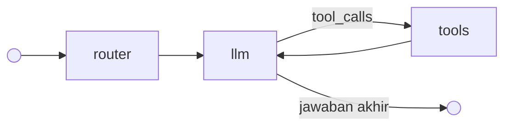

# AgenticAI LangGraph

Kumpulan aplikasi LangGraph yang disusun bertingkat: mulai dari satu node
sederhana sampai agent dengan routing semantik, tool calling, streaming, dan
memori jangka pendek maupun jangka panjang.

Project ini bersifat eksperimental/edukasi. Fokusnya bukan pada seberapa pintar
modelnya, tapi pada **bagaimana graph dirakit** dan bagaimana keputusan routing
bisa diukur, bukan dikira-kira.

---

## Tingkatan aplikasi

Jalankan secara berurutan kalau kamu sedang mempelajari project ini.

| File | Konsep yang diajarkan |
| --- | --- |
| [`app.py`](app.py) | Graph paling sederhana: `START -> call_model -> END`, state berupa `TypedDict`. |
| [`app_tools.py`](app_tools.py) | Tool calling dengan `ToolNode` + `tools_condition`, membentuk loop `llm -> tools -> llm`. |
| [`app_conditional.py`](app_conditional.py) | Conditional edge: satu node router memilih salah satu dari dua agent spesialis. |
| [`app_hybrid.py`](app_hybrid.py) | Semuanya digabung: routing, tool, streaming token, pemotongan konteks, checkpointer, dan profil user. |



Diagram di atas adalah bentuk graph `app_hybrid.py`.

---

## Instalasi

```powershell
python -m venv .venv
.\.venv\Scripts\Activate.ps1
pip install -r requirements.txt

# untuk menjalankan test
pip install -r requirements-dev.txt
```

`requirements-lock.txt` berisi versi persis yang pernah teruji, kalau kamu
butuh lingkungan yang identik.

### Konfigurasi `.env`

```dotenv
# Provider: deepseek | mimo | zai | ifm
MODEL_PROVIDER=ifm

# Isi sesuai provider yang dipilih.
IFM_API_KEY=...

# Opsional
MODEL_NAME=IFM/K2-Horizon-375B-A23B
MODEL_TEMPERATURE=0.2
MODEL_MAX_TOKENS=512
MODEL_TIMEOUT=60
MODEL_MAX_RETRIES=2
LOG_LEVEL=INFO

# Opsional: batas riwayat yang dikirim ke model (lihat "Memori")
MAX_CONTEXT_TOKENS=2048
MAX_RECENT_MESSAGES=12
```

Provider didefinisikan di [`config.py`](config.py). Menambah provider baru
cukup menambah satu entri pada dict `PROVIDERS` dan satu variabel API key.

---

## Arsitektur modul

Aplikasi `app_*.py` sengaja dibuat tipis. Logika yang bisa dipakai ulang
dipisah ke modul:

| Modul | Isi |
| --- | --- |
| [`config.py`](config.py) | Registrasi provider, `get_llm_settings()`. |
| [`llm.py`](llm.py) | Factory `get_llm()` dan adapter `IFMChatOpenAI`. |
| [`router.py`](router.py) | Sampel intent, embedding, dan `semantic_route()`. |
| [`tools.py`](tools.py) | Tool yang bisa dipanggil model. |
| [`profile_memory.py`](profile_memory.py) | Memori jangka panjang (preferensi & nama user). |
| [`log.py`](log.py) | `get_logger()` dengan level dari `LOG_LEVEL`. |
| [`router_eval.py`](router_eval.py) | Dataset + pengukuran akurasi router. |

Semua modul memakai inisialisasi **lazy** (`lru_cache`). Efeknya:

* mengimpor modul tidak butuh API key maupun memuat model embedding, jadi
  test berjalan tanpa kredensial;
* model embedding (±15 detik) hanya dimuat saat routing benar-benar dipakai.

Adapter `IFMChatOpenAI` ada karena provider IFM mengirim field non-standar
`reasoning` pada respons. `check_ifm.py` dan `check_langchain_message.py`
adalah skrip untuk memverifikasi perilaku tersebut.

---

## Router semantik

Routing dilakukan dengan embedding + nearest neighbour, **bukan** dengan
memanggil LLM. Hasilnya: nol biaya API, latensi rendah, dan bisa diuji.

Cara kerjanya ([`router.py`](router.py)):

1. 26 sampel intent di-embed ke vector store Chroma in-memory.
2. Pertanyaan user dicocokkan dengan tetangga terdekat.
3. Kalau jaraknya melebihi `MAX_ROUTE_DISTANCE` (1.02), pertanyaan dianggap di
   luar topik dan jatuh ke rute `general`.
4. **Unanimity rescue**: kalau jaraknya lewat tapi seluruh `top_k` tetangga
   sepakat satu rute, rute itu tetap dipakai selama jaraknya masih di bawah
   `RESCUE_DISTANCE` (1.20).

Poin 4 penting. Model embedding yang dipakai menghasilkan jarak yang besar
untuk teks pendek (0.3–1.4), sehingga ambang batas absolut saja terlalu agresif
dan menolak pertanyaan yang sebenarnya valid. Kesepakatan penuh antar tetangga
menandakan pertanyaan berada di dalam cluster rute tersebut, sedangkan
ketidaksepakatan berarti posisinya di perbatasan — kasus yang memang sebaiknya
jatuh ke `general`.

### Hasil kalibrasi

Angka diukur, bukan diasumsikan. Dataset dibagi dua supaya tidak overfit:

| Dataset | Rute benar | Out-of-scope tertangkap |
| --- | --- | --- |
| DEV (38 kasus, dipakai saat kalibrasi) | 30/30 (100%) | 8/8 (100%) |
| HELDOUT (20 kasus, tidak pernah dipakai saat kalibrasi) | 14/15 (93.3%) | 5/5 (100%) |

```powershell
python router_eval.py
```

Beberapa desain yang sudah dicoba dan **ditolak** karena hasilnya lebih buruk:

* *majority vote* antar `top_k` tetangga — akurasi nearest-neighbour tunggal
  sudah 97,8%, voting hanya menambah kompleksitas;
* normalisasi jarak per rute — akurasi HELDOUT justru turun jadi 73%;
* ambang batas absolut tanpa rescue — HELDOUT turun jadi 80%.

---

## Tool

Empat tool ada di [`tools.py`](tools.py), dipilih karena model memang tidak
bisa mengerjakannya sendiri secara andal:

| Tool | Fungsi |
| --- | --- |
| `calculate` | Arithmetic presisi lewat AST whitelist, bukan `eval()`. |
| `current_datetime` | Tanggal/waktu saat ini. |
| `read_project_file` | Membaca file sumber proyek. |
| `list_project_files` | Mendaftar file proyek. |

Tool dijalankan atas nama model, yang bisa menjadi sasaran *prompt injection*.
Karena itu:

* `calculate` hanya menerima literal angka, operator aritmetika, dan fungsi
  dari whitelist. Pangkat dibatasi supaya `9 ** 9 ** 9` tidak menggantung.
* `read_project_file` menolak `.env`, `credentials.json`, `*.key/pem/p12/pfx`,
  dan direktori `.git`/`.venv`. Tanpa ini, satu suntikan prompt bisa membuat
  API key ikut terkirim ke provider.
* Path traversal diblokir dengan resolve + `relative_to` root proyek. Pemisah
  path dinormalisasi dulu dan path absolut (termasuk drive letter Windows)
  ditolak sebelum operasi filesystem, supaya perilakunya identik di Windows dan
  Linux. Di POSIX, `C:\Windows\win.ini` adalah satu nama file yang sah, jadi
  tanpa normalisasi path itu lolos dan hanya gagal sebagai *file not found*.

---

## Menjalankan `app_hybrid.py`

```powershell
python app_hybrid.py
```

Perintah dalam sesi:

| Perintah | Fungsi |
| --- | --- |
| `/new` | Percakapan baru (thread id baru). |
| `/reset` | Percakapan baru **dan** hapus profil tersimpan. |
| `/thread` | Lihat thread id saat ini. |
| `/thread <id>` | Lanjutkan percakapan tertentu. |
| `/profile` | Lihat profil long-term yang tersimpan. |
| `/help` | Daftar perintah. |

Dua jenis memori yang bekerja bersamaan:

* **Jangka pendek** — `SqliteSaver` (`checkpoints.sqlite`), terikat pada
  `thread_id`. Ini yang membuat agent ingat konteks percakapan. Isinya bisa
  dilihat dengan `python inspect_checkpoints.py`.
* **Jangka panjang** — `profile_memory.sqlite`, terikat pada `user_id` dan
  bertahan lintas sesi. Menyimpan nama, bahasa, dan gaya jawaban.

`thread_id` dan `user_id` sengaja dipisah: satu orang bisa punya banyak
percakapan, dan satu percakapan tetap milik orang yang sama.

Konteks yang dikirim ke model dipotong otomatis lewat dua batas yang bisa
diatur dari `.env`: `MAX_RECENT_MESSAGES` (jumlah pesan) lalu
`MAX_CONTEXT_TOKENS` (jumlah token). Pemotongan hanya memengaruhi apa yang
dilihat model — riwayat lengkap tetap utuh di checkpointer.

Urutannya penting dan disengaja: batas jumlah pesan diterapkan **lebih dulu**,
baru `trim_messages` dengan `start_on="human"`. Kalau dibalik, pemotongan
jumlah akan mengabaikan `start_on` dan jendela riwayat bisa dimulai dari
tengah giliran — termasuk diawali `ToolMessage` tanpa `AIMessage(tool_calls)`
pendahulunya, kondisi yang ditolak API. Akibat dari urutan yang benar:
`MAX_RECENT_MESSAGES` adalah batas atas, bukan jaminan jumlah pesan. Sisa
potongan yang berada di tengah giliran ikut dibuang, jadi jendela yang benar-
benar aman bisa lebih pendek dari angkanya. Perilaku ini dikunci oleh
`test_context_trimming.py`.

---

## Test

```powershell
pytest
```

81 test, semuanya offline: tidak ada satu pun yang memanggil API.
[`conftest.py`](conftest.py) menanam API key dummy sebelum modul proyek
diimpor, jadi test berjalan tanpa `.env` yang benar dan tanpa biaya API.

| File | Mencakup |
| --- | --- |
| `test_profile_preferences.py` | Deteksi preferensi permanen vs instruksi sementara. |
| `test_tools.py` | Kalkulator menolak kode arbitrer, file kredensial terblokir, path traversal terblokir. |
| `test_context_trimming.py` | Pemotongan konteks: batas token, batas jumlah pesan, dan jaminan jendela selalu mulai dari giliran user. |
| `test_graph.py` | Graph yang sudah di-compile dijalankan beneran dengan model berskrip: loop tool, error tool, checkpointer, dan pemisahan thread. |
| `test_router_eval.py` | Akurasi router pada dataset DEV dan HELDOUT, plus smoke test node router di aplikasi. |

`test_router_eval.py` memuat model embedding sehingga butuh ±2 menit pada run
pertama. Untuk melewatinya saat sedang cepat-cepat:

```powershell
pytest -m "not slow"
```

`test_graph.py` memakai `FakeMessagesListChatModel` dari `langchain_core` yang
di-subclass supaya `bind_tools` tidak melempar `NotImplementedError`. Routing
semantik di-stub di sana karena sudah diuji terpisah di `test_router_eval.py`.

---

## Continuous integration

[`ci.yml`](.github/workflows/ci.yml) menjalankan `ruff check .` dan
`pytest -m "not slow"` pada Python 3.10 dan 3.12 setiap push dan pull request.
Workflow ini tidak butuh secret apa pun, karena suite-nya offline.

Evaluasi router (`python router_eval.py`) tidak ikut di setiap push karena
memuat model embedding ±1 GB. Jalankan manual lewat tab **Actions →
Run workflow** kalau kamu mengubah `ROUTING_SAMPLES` atau ambang batas jarak.

---

## Keterbatasan yang diketahui

* **Routing tidak selalu cocok dengan intuisi.** Pertanyaan aritmetika seperti
  "what is 123 * 45?" bisa masuk ke rute `ml`, karena secara semantik mirip
  dengan sampel "train machine learning models". Ini konsekuensi dari routing
  berbasis embedding: yang diukur adalah kedekatan makna, bukan kategori
  buatan manusia. Tool `calculate` tetap terpanggil karena keputusan tool ada
  di tangan model, jadi jawabannya tetap benar — hanya prompt sistemnya kurang
  spesifik. Cara memperbaikinya bukan dengan mengatur ambang batas, tapi
  dengan menambah sampel intent matematika ke `ROUTING_SAMPLES` lalu
  mengkalibrasi ulang lewat `python router_eval.py`.
* **Streaming IFM butuh adapter khusus.** Provider IFM menolak riwayat
  multi-turn yang pesan assistant-nya tidak punya field `reasoning`, tapi
  LangChain membuang field itu pada respons streaming. `IFMChatOpenAI`
  memulihkannya lewat `_convert_chunk_to_generation_chunk`. Kalau kamu
  mengganti provider, adapter ini tidak diperlukan.
* **Ekstraksi bahasa hanya mengenal dua bahasa.** `LANGUAGE_PATTERNS` di
  `profile_memory.py` hanya punya pola untuk English dan Indonesian. Kalimat
  seperti "untuk kali ini saja jawab dalam bahasa Jepang" lolos dari deteksi,
  jadi override sementara tidak terjadi. Menambah bahasa berarti menambah
  pasangan pola `strict`/`loose` baru, bukan mengubah logikanya.
* **Embedding berjalan di CPU** dan butuh ±15 detik saat dimuat. Set
  `EMBEDDING_DEVICE=cuda` kalau tersedia.

---

## Catatan

* `checkpoints.sqlite`, `profile_memory.sqlite`, dan `.env` tidak di-commit.
* Skrip `check_*.py` dan `inspect_checkpoints.py` adalah alat inspeksi, bukan
  bagian dari aplikasi. `check_ifm_multiturn.py` memanggil API sungguhan, jadi
  butuh API key dan tidak ikut dalam test suite.
